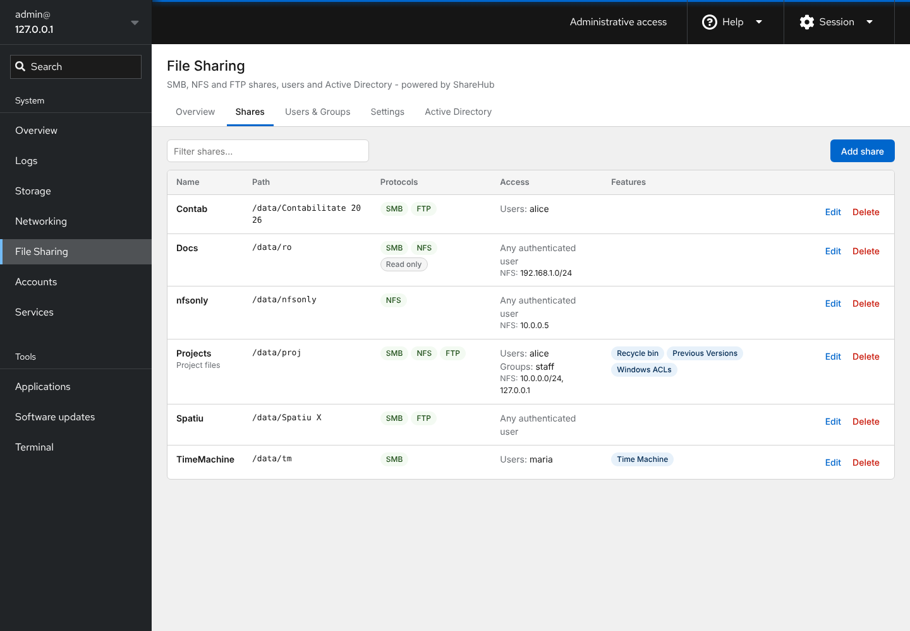
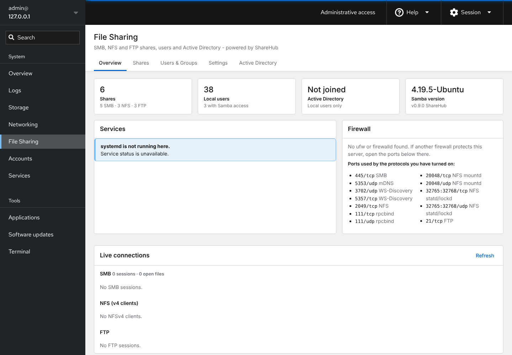
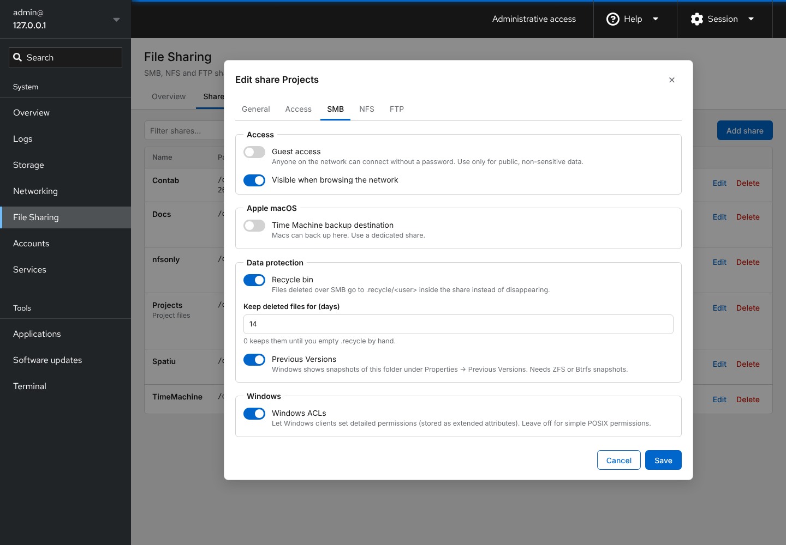
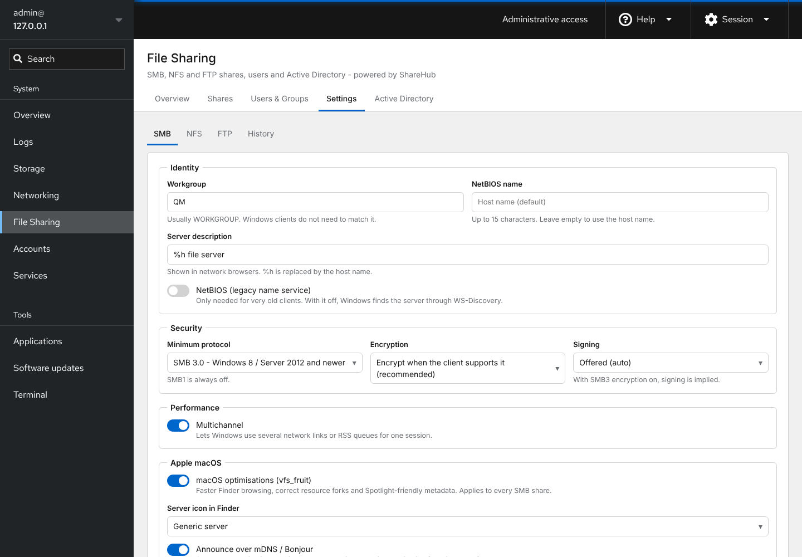

# ShareHub - file sharing for Cockpit

ShareHub adds a **File Sharing** page to [Cockpit](https://cockpit-project.org/) for managing SMB, NFS and FTP from one place. A share is one folder, published over any mix of **SMB, NFS and FTP/FTPS**, with one list of allowed users and groups.



## Features

- **Size limits per share.** Enforced by the filesystem: ZFS datasets, XFS and ext4 project quotas, or Btrfs subvolumes. The share list shows a usage bar.
- **One share, three protocols.** Switch SMB, NFS and FTP on and off per folder. SMB and FTP use the same users and groups; NFS uses a list of allowed client machines.
- **Users and groups.** Local accounts with **one password for the system and Samba**, so FTP, SSH and SMB logins never drift apart. You can enable or disable each user's Samba account.
- **Home folders.** Each user gets `\\server\<user>` over SMB and `/home/<user>` over FTP, and nobody can see anyone else's home.
- **macOS.** Optional `vfs_fruit` tuning, **Time Machine** destinations with a size limit, and Bonjour (mDNS) announcements.
- **Windows.** **Previous Versions** from ZFS snapshots (sanoid, zfs-auto-snapshot) or Btrfs snapshots (snapper), optional Windows ACLs, and WS-Discovery so the server shows up under *Network*.
- **Versioning.** Read-only versions of a share every 15 minutes or hourly (ZFS or Btrfs), with hourly/daily/weekly/monthly retention. Users and ransomware cannot change them. Windows shows them as *Previous Versions*, and the admin restores any file or folder from the UI.
- **Recycle bin.** Files deleted over SMB are kept, optionally hidden from users, with a limit on versions per file and a retention period. Restore them from the UI.
- **Active Directory.** A join wizard with prerequisite checks, winbind with `rid` or `ad` ID mapping, and domain users and groups in every access list.
- **FTP done safely.** ProFTPD with every user jailed to the shares they are allowed to see. Each share appears as a bind mount. FTPS can be required.
- **Components dashboard.** Shows, for each feature, the packages, services and configuration it needs, highlights what is in use but broken, and installs, starts or fixes it in one click.
- **Operations.** Service status, live SMB/NFS/FTP sessions (including disconnecting a session), firewall port helpers for ufw and firewalld, and a change history you can restore from.
- **Safe changes.** Every change is validated (`testparm`, `exportfs`, `proftpd -t`) before it is kept. If anything fails, the previous configuration is put back.
- **Import.** Takes over shares created by the 45Drives *File Sharing* module, NFS exports from `/etc/exports`, and the earlier cockpit-smbftp prototype.

| Overview | Share editor | Settings |
|---|---|---|
|  |  |  |

## Quick start (Ubuntu 24.04)

1. Download the latest `cockpit-sharehub_*_all.deb` from [Releases](https://github.com/Ancyent/cockpit_sharehub/releases).
2. Install it:

   ```bash
   sudo apt install ./cockpit-sharehub_*_all.deb
   ```

3. Open `https://<server>:9090` and log in with an administrator account.
4. Turn on **administrative access** and open **File Sharing**.
5. On the first visit, click **Enable registry**.

Full instructions, including installing from source, are in **[docs/INSTALL.md](docs/INSTALL.md)**.

## Documentation

| Document | Contents |
|---|---|
| [INSTALL.md](docs/INSTALL.md) | Requirements, installation, first run, firewall, upgrade, removal, troubleshooting |
| [USER_GUIDE.md](docs/USER_GUIDE.md) | Every screen and option, with recommendations |
| [ARCHITECTURE.md](docs/ARCHITECTURE.md) | How ShareHub works: state, reconciliation, files it writes, helper commands |
| [TESTING.md](docs/TESTING.md) | Automated tests, what has been verified, and a manual test checklist |
| [PLAN.md](docs/PLAN.md) | Roadmap and status |
| [CONTRIBUTING.md](CONTRIBUTING.md) | Development setup and contribution rules |

## Status

**Version 0.13.0 is a release candidate.** The core features are tested against real Samba 4.19 and ProFTPD 1.3.8 on Ubuntu 24.04, and the user interface against Cockpit 314.

Four areas still need validation on real infrastructure:
- NFS client mounts;
- joining a real Active Directory domain;
- Time Machine backups from a Mac;
- service management under systemd.

See [TESTING.md](docs/TESTING.md) for what is verified and what is not. Version 1.0 follows once the field checklist passes.

## Supported systems

- **Target:** Ubuntu 24.04 LTS.
- **Field-tested:** Debian 13 in a Proxmox LXC container (no NFS server in containers; see [INSTALL.md](docs/INSTALL.md)).
- **Expected to work, not yet tested:** Ubuntu 22.04 LTS and Debian 12.
- **Requires:** Cockpit 264 or newer, Samba 4.15 or newer, Python 3.10 or newer.

## License

Copyright (C) 2026 cockpit_sharehub contributors.

ShareHub is free software, released under the [GNU General Public License v3.0 or later](LICENSE).
